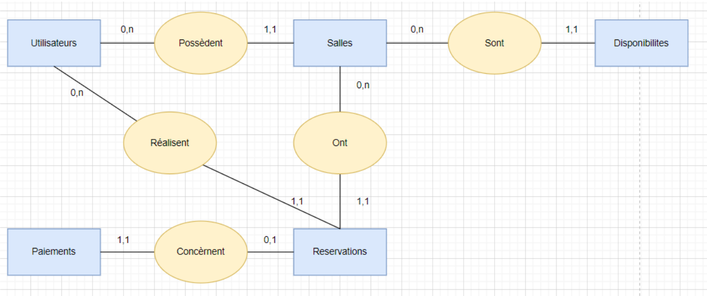

# Base de données

PostgreSQL, accédé via TypeORM (`apps/backend/src/models/`). Les tables et colonnes sont en `snake_case`, les propriétés des entités en `camelCase`.

## MCD

| Association | Cardinalités                      | Traduction                         |
| ----------- | --------------------------------- | ---------------------------------- |
| Possèdent   | Utilisateur 0,n — Salle 1,1       | `rooms.owner_id`                   |
| Sont        | Salle 0,n — Disponibilité 1,1     | `availabilities.room_id`           |
| Réalisent   | Utilisateur 0,n — Réservation 1,1 | `reservations.user_id`             |
| Ont         | Salle 0,n — Réservation 1,1       | `reservations.room_id`             |
| Concernent  | Réservation 0,1 — Paiement 1,1    | `payments.reservation_id` (unique) |

## MLD

- **users** (<u>id</u>, first_name, last_name, email, password_hash, role, created_at)
- **rooms** (<u>id</u>, #owner_id, name, description, capacity, location, equipment, price_per_hour, status, image_url, created_at)
- **availabilities** (<u>id</u>, #room_id, date, start_time, end_time, is_available)
- **reservations** (<u>id</u>, #user_id, #room_id, start_at, end_at, status, number_of_participants, comment, total_amount, currency, rejection_reason, created_at)
- **payments** (<u>id</u>, #reservation_id, external_transaction_id, amount, currency, payment_method, status, payment_url, created_at)

## Tables

### users

| Colonne       | Type           | Contraintes                                                               |
| ------------- | -------------- | ------------------------------------------------------------------------- |
| id            | `uuid`         | PK, généré                                                                |
| first_name    | `varchar(100)` | NOT NULL                                                                  |
| last_name     | `varchar(100)` | NOT NULL                                                                  |
| email         | `varchar(255)` | NOT NULL, UNIQUE                                                          |
| password_hash | `varchar(255)` | NOT NULL                                                                  |
| role          | `enum`         | NOT NULL, `CLIENT` \| `GESTIONNAIRE` \| `ADMINISTRATEUR`, défaut `CLIENT` |
| created_at    | `timestamptz`  | NOT NULL, défaut `now()`                                                  |

### rooms

| Colonne        | Type            | Contraintes                                       |
| -------------- | --------------- | ------------------------------------------------- |
| id             | `uuid`          | PK, généré                                        |
| owner_id       | `uuid`          | NOT NULL, FK → `users.id`, ON DELETE CASCADE      |
| name           | `varchar(100)`  | NOT NULL                                          |
| description    | `text`          | NULL                                              |
| capacity       | `int`           | NOT NULL, `>= 1`                                  |
| location       | `varchar(255)`  | NOT NULL                                          |
| equipment      | `text[]`        | NOT NULL, défaut `{}`                             |
| price_per_hour | `decimal(10,2)` | NOT NULL, `>= 0`                                  |
| status         | `enum`          | NOT NULL, `ACTIVE` \| `INACTIVE`, défaut `ACTIVE` |
| image_url      | `varchar(2048)` | NULL                                              |
| created_at     | `timestamptz`   | NOT NULL, défaut `now()`                          |

### availabilities

Un créneau d'une salle pour une date donnée. `PUT /rooms/{roomId}/availability` remplace tous les créneaux de la date. Les heures n'ont pas de fuseau : heure de Paris (cf. `cadrage.md`).

| Colonne      | Type      | Contraintes                                  |
| ------------ | --------- | -------------------------------------------- |
| id           | `uuid`    | PK, généré                                   |
| room_id      | `uuid`    | NOT NULL, FK → `rooms.id`, ON DELETE CASCADE |
| date         | `date`    | NOT NULL                                     |
| start_time   | `time`    | NOT NULL                                     |
| end_time     | `time`    | NOT NULL, `> start_time`                     |
| is_available | `boolean` | NOT NULL, défaut `true`                      |

Index : (`room_id`, `date`).

### reservations

| Colonne                | Type            | Contraintes                                                                                      |
| ---------------------- | --------------- | ------------------------------------------------------------------------------------------------ |
| id                     | `uuid`          | PK, généré                                                                                       |
| user_id                | `uuid`          | NOT NULL, FK → `users.id`, ON DELETE RESTRICT                                                    |
| room_id                | `uuid`          | NOT NULL, FK → `rooms.id`, ON DELETE RESTRICT                                                    |
| start_at               | `timestamptz`   | NOT NULL                                                                                         |
| end_at                 | `timestamptz`   | NOT NULL, `> start_at`                                                                           |
| status                 | `enum`          | NOT NULL, `PENDING` \| `CONFIRMED` \| `REJECTED` \| `CANCELLED` \| `COMPLETED`, défaut `PENDING` |
| number_of_participants | `int`           | NULL, `>= 1`                                                                                     |
| comment                | `text`          | NULL                                                                                             |
| total_amount           | `decimal(10,2)` | NOT NULL, `>= 0` (figé à la création : le prix de la salle peut changer)                         |
| currency               | `char(3)`       | NOT NULL, défaut `EUR`                                                                           |
| rejection_reason       | `text`          | NULL (corps de `POST /reservations/{id}/reject`)                                                 |
| created_at             | `timestamptz`   | NOT NULL, défaut `now()`                                                                         |

Index : (`room_id`, `start_at`) pour la vérification des chevauchements, (`user_id`).

### payments

| Colonne                 | Type            | Contraintes                                                               |
| ----------------------- | --------------- | ------------------------------------------------------------------------- |
| id                      | `uuid`          | PK, généré                                                                |
| reservation_id          | `uuid`          | NOT NULL, UNIQUE, FK → `reservations.id`, ON DELETE RESTRICT              |
| external_transaction_id | `varchar(255)`  | NULL (renseigné par le prestataire de paiement)                           |
| amount                  | `decimal(10,2)` | NOT NULL, `>= 0`                                                          |
| currency                | `char(3)`       | NOT NULL, défaut `EUR`                                                    |
| payment_method          | `enum`          | NOT NULL, `CARD` \| `PAYPAL`                                              |
| status                  | `enum`          | NOT NULL, `PENDING` \| `PAID` \| `FAILED` \| `REFUNDED`, défaut `PENDING` |
| payment_url             | `varchar(2048)` | NULL                                                                      |
| created_at              | `timestamptz`   | NOT NULL, défaut `now()`                                                  |

## Écarts corrigés par rapport au premier schéma

Comparé au contrat `packages/core/openapi.yml` :

- **users** : ajout de `first_name` et `last_name` (requis par `User` et `RegisterRequest`).
- **rooms** : ajout de `location` et `status` (requis par `Room`), `equipment`, `image_url` et `created_at`.
- **availabilities** : ajout de `date` et `is_available`. L'API manipule des créneaux `{ startTime, endTime, available }` rattachés à une date.
- **reservations** :
  - `start_time` et `end_time` deviennent `start_at` et `end_at` (`timestamptz`, comme `startAt` et `endAt`).
  - Ajout de `total_amount` (requis par `Reservation`), `number_of_participants`, `comment`, `currency`, `rejection_reason` et `created_at`.
- **payments** : ajout de `currency` (requis), `payment_method` (envoyé par `POST /payments`), `payment_url` et `created_at`.
- **Suppressions** : `ON DELETE RESTRICT` sur les réservations. `DELETE /rooms/{roomId}` doit renvoyer `409` si la salle a des réservations, au lieu de les effacer en cascade.

Hors base : `GET /admin/statistics` est calculé par requêtes d'agrégat, et le `refreshToken` n'est pas stocké (JWT sans état).
