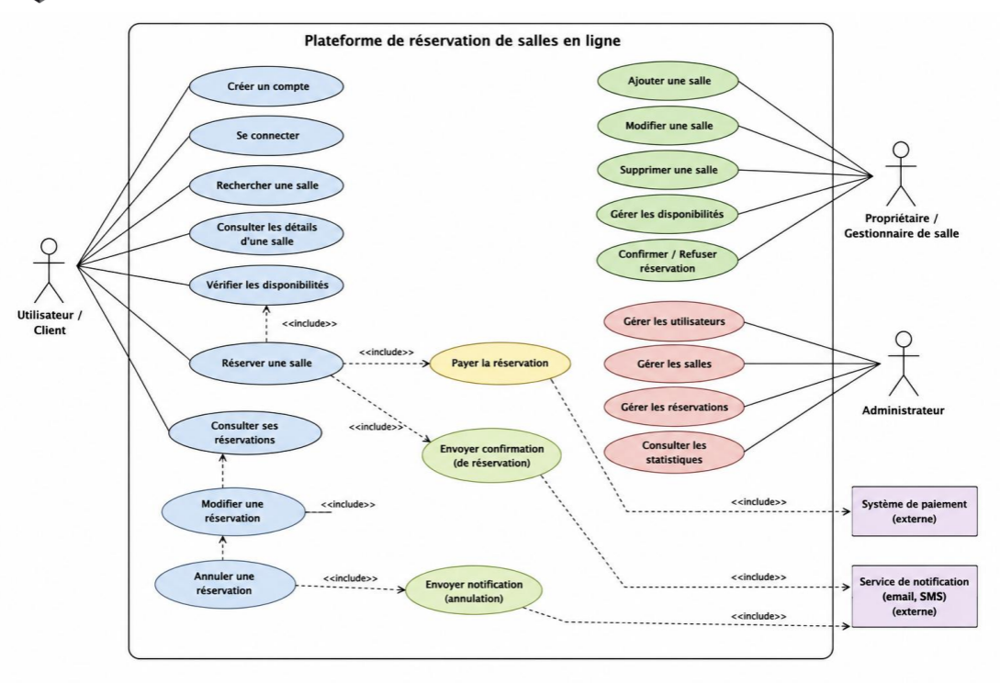

# use cases

Routes issues de [`packages/core/openapi.yml`](../packages/core/openapi.yml)

## User / client

- Créer un compte
  - `POST /auth/register`
- Se connecter
  - `POST /auth/login`
- Rechercher une salle
  - `GET /rooms` (avec filtres)
- Consulter les détails d'une salle
  - `GET /rooms/{roomId}`
- Vérifier les disponibilités
  - `GET /rooms/{roomId}/availability`
- Réserver une salle
  - `POST /reservations`
  - `<<include>>` Vérifier les disponibilités : faite côté serveur par `POST /reservations` (409 si créneau indisponible)
  - `<<include>>` Payer la réservation → Système de paiement (externe)
    - `POST /payments`
    - `GET /payments/{paymentId}`
  - `<<include>>` Envoyer confirmation (de réservation) → Service de notification (externe)
    - pas de route : effet de bord de `POST /reservations/{reservationId}/confirm`
- Consulter ses réservations
  - `GET /reservations`
  - `GET /reservations/{reservationId}`
- Modifier une réservation
  - `PATCH /reservations/{reservationId}`
  - `<<include>>` Consulter ses réservations
- Annuler une réservation
  - `DELETE /reservations/{reservationId}` (passage au statut `CANCELLED`)
  - `<<include>>` Modifier une réservation
  - `<<include>>` Envoyer notification (annulation) → Service de notification (externe)
    - pas de route : effet de bord de `DELETE /reservations/{reservationId}`

## owner / room manager

- Ajouter une salle
  - `POST /rooms`
- Modifier une salle
  - `PATCH /rooms/{roomId}`
- Supprimer une salle
  - `DELETE /rooms/{roomId}`
- Gérer les disponibilités
  - `GET /rooms/{roomId}/availability`
  - `PUT /rooms/{roomId}/availability`
- Confirmer / Refuser une réservation
  - `GET /reservations`
  - `POST /reservations/{reservationId}/confirm`
  - `POST /reservations/{reservationId}/reject`

## admin

- Gérer les utilisateurs
  - `GET /users`
  - `GET /users/{userId}`
  - `PATCH /users/{userId}`
  - `DELETE /users/{userId}`
- Gérer les salles
  - `GET /rooms` 
  - `POST /rooms`
  - `PATCH /rooms/{roomId}` 
  - `DELETE /rooms/{roomId}`
  - `PUT /rooms/{roomId}/availability`
- Gérer les réservations
  - `GET /admin/reservations`
  - `GET /reservations/{reservationId}`
  - `POST /reservations/{reservationId}/confirm`
  - `POST /reservations/{reservationId}/reject`
- Consulter les statistiques
  - `GET /admin/statistics`

## Systèmes externes

- Système de paiement : `POST /payments` puis mock
- Service de notification (email, SMS)

## Routes hors diagramme

- `GET /auth/me` : profil de l'utilisateur connecté
- `PATCH /auth/me` : modifier son profil (prénom, nom, e-mail ; pas le rôle)
- `PATCH /auth/password` : modifier son mot de passe
